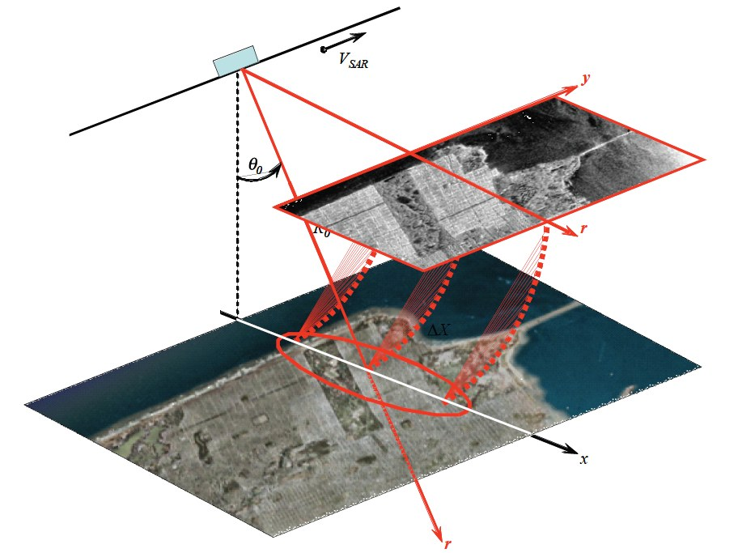
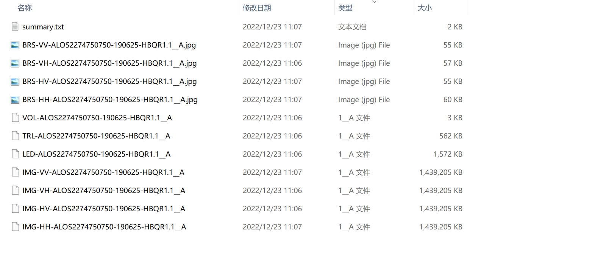
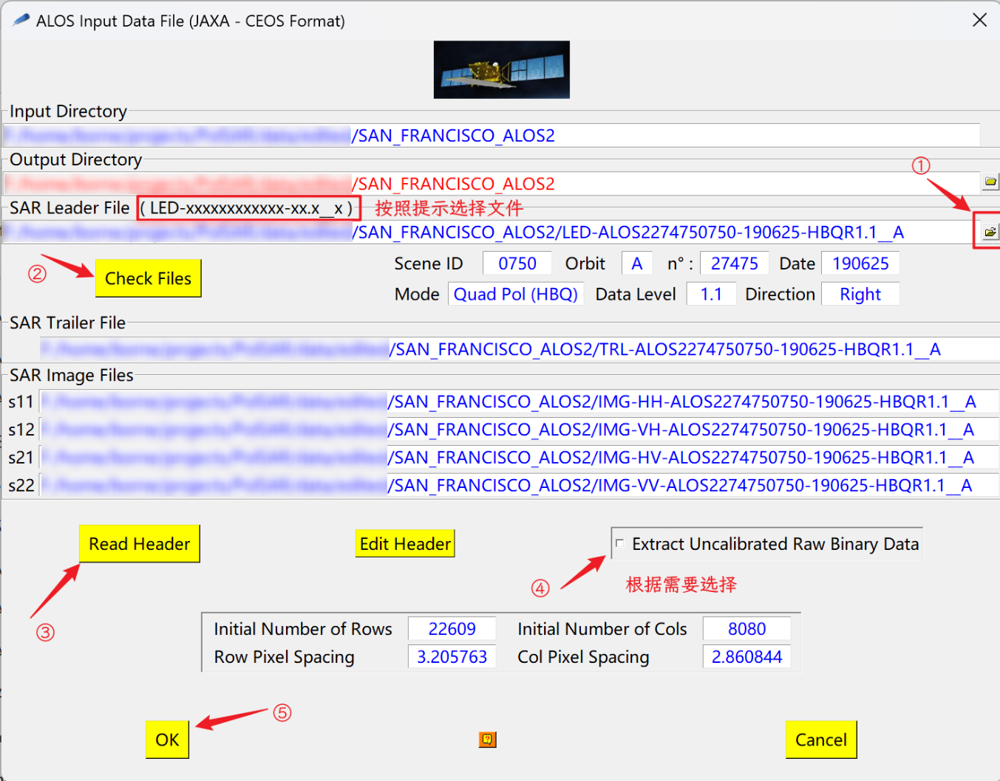
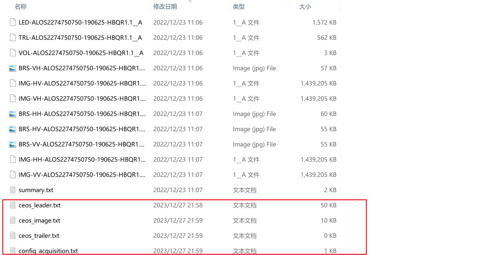
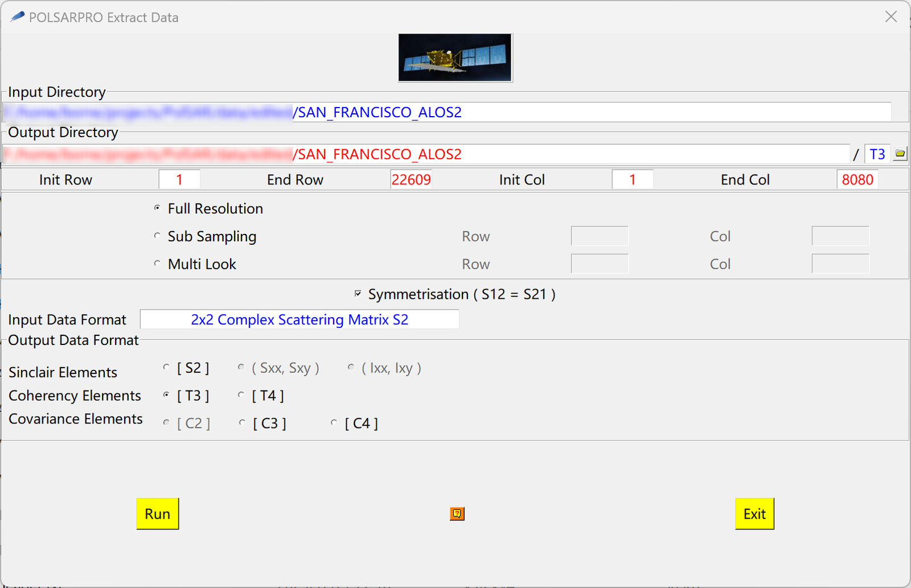
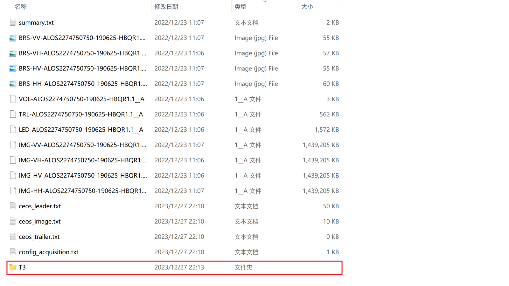
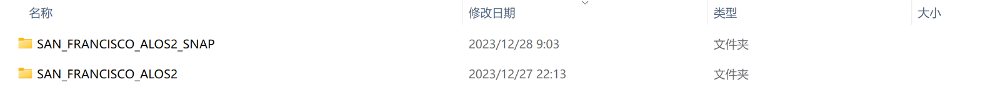
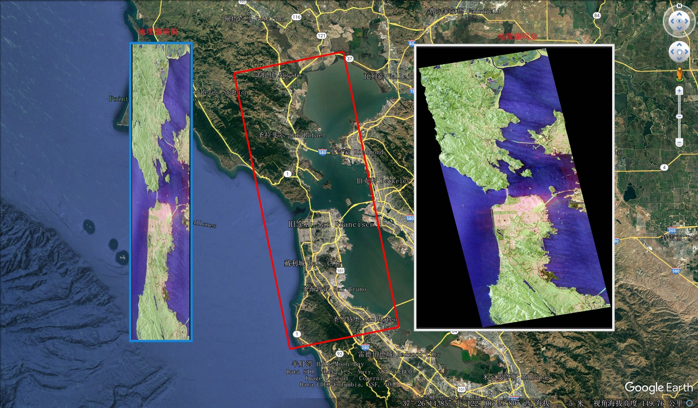

## 1. 关于地理编码（Geocode）

简单来说，地理编码就是赋予极化 SAR 数据地理位置信息（比如：经、纬度）。最终经过地理编码过后的极化 SAR 数据能实现与真实地理地图的相应区域 $$1:1$$ 的贴合。

之所以要进行地理编码，是因为 SAR 成像系统是一种侧视雷达传感器，其照射方向垂直于航线方向。因此，SAR 图像存在三种固有的几何失真。这种失真是由斜距（slant-range）和地距（ground-range）之间的差异造成的[^1]。
<!--more-->

## 2. 利用 PolSARpro 进行 Geocode

### 2.1 使用的数据

本节使用了 ALOS-2 获取的 San Francisco 地区 L 波段的数据[^2]来展示 Geocode 的过程。

一份原始的 ALOS-2 数据，包含了如下图所示的这些文件，

### 2.2 提取极化 SAR 图像

在对数据进行 Geocode 之前，需要先从原始数据中提取出极化 SAR 图像，具体过程如下，

> 下面的过程与之前的文章 《SAR原始数据处理》中的过程类似。

1. 选择相应的卫星（ALOS-2）导入数据，ALOS 输入数据文件（Import $$\rightarrow$$ Spaceborne Sensors $$\rightarrow$$ Alos-2 - Palsar-2 $$\rightarrow$$ Qual - Pol），

   

   

2. 提取极化 SAR 图像（Extract PolSAR images, Import $$\rightarrow$$ Extract PolSAR images），

   

   

### 2.3 地理编码（Geocode）

对提取得到的极化 SAR 图像（ T3 矩阵）利用 SNAP 工具箱进行地理编码（Geocode, Utilities $$\rightarrow$$ SNAP - S1 TBX $$\rightarrow$$ Geocode [T3] matrix），

![Geocode [T3] matrix](../assets/images/posts/2024-01-19/image-20231227223247938-8d729695.png)

关于上面利用 SNAP 工具箱进行地理编码的过程有几点需要说明，

1. 图像重采样方法（Image Resampling Method）选择 Cubic 可能会报错，如果报错，选择默认的 Bilinear 即可；
2. Source GR Pixel Spacings 表示的是多视平均过程，可以保持多视的输入和输出不变，即：不进行多视平均处理；
3. 对于单视复（Single Look Complex，SLC）数据，进行 Geocode 后会破坏其 Single Look 的性质，即使选择不进行 Source GR Pixel Spacings。

进行地理编码之后，会在当前环境（Environment）设置的主目录的同级目录下生成一个新文件夹，

## 3. 小结

对极化 SAR 图像进行 Geocode，对于后续对极化 SAR 图像进行实际应用有极大裨益，下面展示了Geocode 前后的极化 SAR 图像比较，可以看到经过地理编码过后的极化 SAR 数据能实现与真实地理地图的相应区域 $$1:1$$ 的贴合。

## 参考

[^1]: LEE J S, POTTIER E. Polarimetric radar imaging: from basics to applications[M/OL]. Boca Raton: Taylor and Francis, 2009.

[^2]: 可以通过在公众号后台回复相应关键词获取到相应的极化 SAR 数据。

